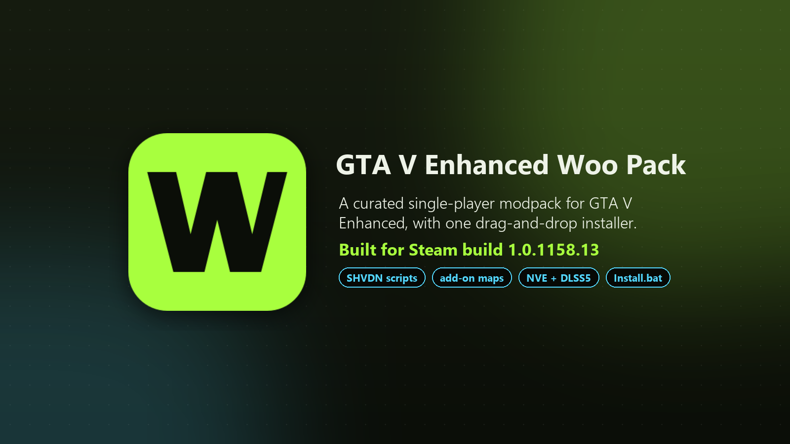
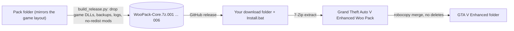

<div align="center">



[](https://github.com/SenjuWoo/gta5-enhanced-woo-pack/actions/workflows/ci.yml)
[](https://github.com/SenjuWoo/gta5-enhanced-woo-pack/releases/latest)
[](#compatibility)
[](CREDITS.md)

**[Install](#install)** · **[What's inside](#whats-inside)** · **[Compatibility](#compatibility)** · **[Troubleshooting](#troubleshooting)** · **[How it works](#how-it-works)** · **[Credits](CREDITS.md)** · **[Changelog](CHANGELOG.md)**

</div>

The Woo Pack is a ready-to-play single-player mod layer for **GTA V Enhanced** on
Steam. One download holds the script hook, ScriptHookVDotNet, the NaturalVision
Evolved graphics overhaul with its ReShade preset, the DLSS 5 add-on, a stack of
story-mode script mods and 14 add-on mansions and interiors, all pre-wired through
Onigiri. Download every release volume, run `Install.bat`, launch the game. You
bring your own copy of GTA V Enhanced; the pack never ships Rockstar's files.

## What you get

- **Everything in one install.** ScriptHookV `3889.0`, ScriptHookVDotNet Enhanced `1.1.0.6` and an ASI loader, so scripts load without a separate download.
- **Graphics stack included.** NVE (NaturalVision Evolved, June 2026 "NEXT GEN UPDATE" build) with its ReShade preset and 12 environment packs, plus the **DLSS 5 neural-rendering add-on** (RenoDX) with current NVIDIA Streamline runtimes.
- **Story-mode script mods.** Odd jobs, Madrazo hits, Online workshops and vehicle shops in SP, the Vinewood car club, taxi work, fuel, traffic, gestures and more ([full list](CREDITS.md#script-mods)).
- **Add-on maps and interiors.** Playboy Mansion, Madrazo Ranch, Pine Valley, Malibu, Desert, Mafia and Vinewood Hills mansions, Jason Duval's house, Eclipse Complex, Lively Bahama Mamas, a mechanic garage, Sweet Milk Farm and the MP character overhaul, mounted through [Onigiri](https://www.nexusmods.com/gta5enhanced/mods/688) with `dlclist.xml` already configured.
- **The framework ASIs they need.** Heap and packfile limit adjusters, DirectStorage fix, decal patch, proper steering fix, blinker, Menyoo 2.3.1, SwapMainRide.
- **A merge-only installer.** `Install.bat` finds the Steam game folder, extracts the volumes and copies the mod layer in with `robocopy`. It never deletes a game file.
- **A release builder that keeps the wrong files out.** `build_release.py` splits the pack into GitHub-sized 7z volumes and drops Rockstar's DLLs, the `_DLSS5_Backup` restore stash, logs, debug symbols and every mod whose author forbids redistribution. CI proves it on a test pack.


### Not in this pack

| Left out | Why |
| --- | --- |
| **GTA V Enhanced** itself | You own the game. Rockstar binaries (`steam_api64.dll`, `bink2w64.dll`, `dstorage*.dll` and the rest) are excluded at build time. |
| StoreRobberyEnhanced, Modern Wood House, Bennys Motorworks Revamped (+ BennysMapLoader) | Their authors forbid redistribution. Install them from the original pages if you want them ([CREDITS.md](CREDITS.md)). |

No in-game screenshots are shipped here. The mark is original pack branding, not a Rockstar asset.

## Install

### Requirements

- GTA V Enhanced on Steam, updated to build `1.0.1158.13`
- [7-Zip](https://www.7-zip.org/) to extract the release volumes
- About 10 GB free for the download (six volumes), plus room for the extracted pack

### Steps

1. Download **all** files from the [latest release](https://github.com/SenjuWoo/gta5-enhanced-woo-pack/releases/latest): every `WooPack-Core.7z.00x` volume **and** `Install.bat`. Keep them in the **same folder**.
2. Double-click `Install.bat`. It:
   - finds `Grand Theft Auto V Enhanced` through Steam's registry entry or the usual Steam folders,
   - extracts `WooPack-Core.7z.001` (7-Zip reads the other volumes),
   - merges the pack into the game folder with `robocopy`.
   If it cannot find the game, drag the game folder **onto `Install.bat`** instead (see [Troubleshooting](#troubleshooting)).
3. Launch the game in story mode. On first boot check `ScriptHookV.log` and `ScriptHookVDotNet.log` in the game folder.

Manual route: extract the archive yourself and drop the contents of the `Grand Theft Auto V Enhanced Woo Pack` folder into `steamapps\common\Grand Theft Auto V Enhanced`. The pack mirrors the game folder layout.


### Uninstall

Delete the files the pack copied, then run Steam's "Verify integrity of game files". Verify does not remove leftover mods, so delete those first. A backup of the clean game folder is the safe option.

## What's inside

| Layer | Contents |
| --- | --- |
| Script hook | ScriptHookV `3889.0` (Enhanced), ScriptHookVDotNet Enhanced `1.1.0.6`, ASI loader |
| Graphics | NVE with ReShade (ASI build, NVE preset), DLSS 5 add-on (RenoDX) with NVIDIA Streamline runtimes |
| Scripts | the SHVDN story-mode mods listed in [CREDITS.md](CREDITS.md#script-mods) |
| Add-on packs | 26 DLC packs through Onigiri: 14 add-on maps and interiors plus NVE's 12 environment packs |
| Frameworks | limit adjusters, DirectStorage fix, decal patch, proper steering fix, blinker, Menyoo, SwapMainRide |

Every author, URL and inclusion note is in [`CREDITS.md`](CREDITS.md). That file is the source of truth when mods are added or removed.

## Compatibility

| Item | Value |
| --- | --- |
| Game | **GTA V Enhanced** (Steam), story mode |
| Build | `1.0.1158.13` (July 2026 patch) |
| Script hook | bundled ScriptHookV `3889.0`; a newer game patch needs a matching ScriptHookV |
| DLC overlay | Onigiri, `onigiri\common\data\dlclist.xml` pre-configured |
| Add-on packs | OPEN RPF7 archives, byte-identical to their source releases; they mount with the bundled limit adjusters and DirectStorage fix |

## Troubleshooting

| Symptom | Fix |
| --- | --- |
| "Drag the game folder here" rejects the folder you dropped | Known installer bug: the dropped path arrives in quotes and the check fails. Close the window and drag the game folder **onto `Install.bat`** itself, or run `Install.bat "<game folder>"` from a command prompt. |
| Game loads forever into online/MP | A broken DLC pack. Disable entries one at a time in `onigiri\common\data\dlclist.xml` (comment out `<Item>` lines). |
| Scripts not loading | Check `ScriptHookV.log`. The pack bundles ScriptHookV `3889.0`; a build mismatch there means the game updated past `1.0.1158.13` and needs a newer ScriptHookV from [dev-c.com](https://www.dev-c.com/gta/scripthookv). |
| Black or blank web UI in Online Vehicles Shops | Install that mod's `scaleform_web.rpf` files into `onigiri\update\x64\patch\data\cdimages\scaleform_web.rpf\`. |

## How it works



```text
Install.bat          drag-and-drop installer (also a release asset)
build_release.py     7z volume builder; never packs game DLLs or no-redist mods
CREDITS.md           authors, URLs, inclusion / exclusion notes
tests/               offline tests: release builder on a test pack, Install.bat on a fake game folder
.github/workflows    CI: syntax check, exclusion list, the tests on Linux and Windows
docs/                pack mark and README images (no in-game shots)
```

Building the volumes yourself (maintainers): `python build_release.py <pack folder> <out folder>`, or set
`WOOPACK_PACK_DIR` and `WOOPACK_OUT_DIR`. Old `WooPack-Core.7z.*` volumes in the out folder are replaced.
Tests: `python tests/test_release.py` (needs 7-Zip on PATH; the installer tests run on Windows).

## Status

Verified in this repository:

- CI builds a test pack with `build_release.py` and checks 7-Zip's listing: game DLLs (`amd_ags_x64.dll` and the rest), the no-redistribution mods and `_DLSS5_Backup` never reach a volume.
- CI runs `Install.bat` on Windows against a fake game folder, with the exact release bytes and a CRLF copy, and checks it merges without touching existing game files.
- Release **v1.0.4** holds `WooPack-Core.7z.001` to `.006` plus `Install.bat`; the release `Install.bat` is byte-identical to the one in this repository.

Not claimed: in-game screenshots, or any affiliation with Rockstar Games, Take-Two, Alexander Blade, Razed or the mod authors.

## Credits

This is a **modpack**: a curated collection of independently authored mods. Every included work remains the property of its author, see [`CREDITS.md`](CREDITS.md). If you wrote a listed mod and want it removed or credited differently, open an issue or PR.

GTA, GTA V, GTA V Enhanced and Rockstar are trademarks of their owners. This project is unofficial.

## Licence

No single licence covers the mods. Each entry in [`CREDITS.md`](CREDITS.md) keeps its original terms. The installer, build script and docs in this repository are provided as-is for installing a personal copy of those mods.
